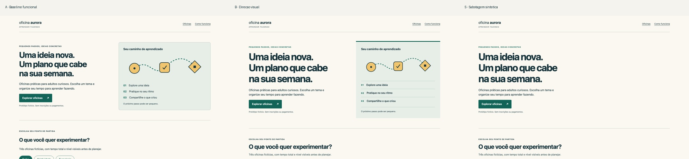

# Cross-category transfer — Oficina Aurora

## Fixed brief and intervention

Fictional educational workshops for adult beginners with limited weekly time. Goal:
choose a topic and calculate a local weekly learning plan. Identity: navy text, green
actions, warm paper, amber geometric original SVG, approachable system typography.
Primary CTA: “Explorar oficinas”. Protected: all text, three workshop names, 6/8/4-hour
durations, beginner levels, fiction/no-enrollment statements, calculation behavior,
SVG and brand colors. Desktop: scan message/action beside learning path. Mobile:
message/action **before** the path, then single-column workshop choices. This is not a
product-photography brief.

Important interaction: topic filtering and a dialog computing `ceil(total hours /
weekly hours)`, with invalid-input feedback and keyboard focus restoration. No real
registration, prices, course availability, payments or external submission.

A is the functional baseline. B appends one original CSS direction patch: clearer stage
separation, larger desktop headline, explicit planning-button treatment and numbered
workshop entries. HTML, JavaScript and the single SVG remain byte-identical. No new
models or images. Same Chromium/Playwright/host, 1440×900 and 390×844 viewports.

One planned visual inspection pass covered hero, full page and interaction captures.
B had no observed defect requiring correction. **C = NOT_NEEDED**, not a fabricated
extra design iteration. This is a valid negative result for “every review improves
presentation.” A remains a viable more compact alternative.

## Separate mutation and repair control

S is an explicitly labeled synthetic copy of B with `.learning-map { opacity:0 }`.
Its geometry, image decoding, navigation and calculation remain valid; required
learning-path information disappears. It is not a candidate direction or an accidental
B defect. The task-specific effective-opacity probe and actual screenshot inspection
both identify it at desktop/mobile.

R removes exactly that declared stylesheet suffix from a separate copy of S. Its four
source files are byte-identical to B, and its two browser retests pass. S is preserved.
R is a mutation restoration control, **not design C**. The evaluator knew the mutation;
this validates detection/restoration of this failure mode, not diagnostic generality.

## Actual evidence

These are real Chromium screenshots of original fictional assets. Full-size captures,
interaction states and private customer review packets remain in the authorized Drive
area. The failed S screenshots are retained, not substituted with a mockup.

| Variant | Desktop | Mobile | Interpretation |
|---|---:|---:|---|
| A | 21/21 PASS | 21/21 PASS | Functional baseline, no observed scoped visual defect |
| B | 21/21 PASS | 21/21 PASS | Direction candidate; human preference unknown |
| S | 20 PASS / 1 FAIL | 20 PASS / 1 FAIL | Required learning path invisible; intentional failure |
| R | 21/21 PASS | 21/21 PASS | Exact local reversal of mutation; matches B source |

Total **166 PASS / 2 FAIL out of 168**. These are assertions, not independent user trials
or 168 creative tasks. Required checks: visibility and content bounds of learning path,
headline fit, primary CTA within the initial viewport for this brief, sampled text
contrast, navigation, filtering, valid/invalid calculation, dialog/focus/Shift+Tab/Escape,
no overflow, image decoding, reduced motion, runtime/resource errors and external actions.
No Della-specific 160px image minimum was reused.

## Separate quality axes

| Axis | A → B observation | Limit / tradeoff |
|---|---|---|
| Aesthetic | B makes ordered stages, workshop numbering and planning buttons more visually explicit | Investigator diagnosis only; no numerical winner or independent preference |
| Fidelity | HTML, JS, SVG and underlying color variables preserved; text and SVG remain visibly present in B | Byte identity alone would incorrectly accept S; final pixels matter |
| Usability | Filter and local calculation work; CTA remains before visual on mobile; focus/error behavior unchanged | User comprehension, task speed and conversion not measured |
| Technical | Both sizes pass all 21 checks; minimum sampled text contrast about 6.74:1 across 16 selected solid-color pairs | Not a full WCAG audit, all states/color combinations or physical-device certification |
| Effort | One baseline, one CSS candidate, one visual review; zero natural repairs, one separate mutation reversal | No independent production-time benchmark or model-success-rate evidence |

| Measured layout/resource fact | A | B |
|---|---:|---:|
| Desktop CTA top | 489.72px | 528.25px |
| Mobile CTA top | 438.42px | 434.42px |
| Desktop learning-path box | 576×426.25px | 528.36×485.48px |
| Mobile learning-path box | 354×351.38px | 354×420px |
| Desktop page height | 1765px | 1922px |
| Mobile page height | 2955px | 3262px |
| Local observed resource transfer | 7,885 bytes | 9,499 bytes |

Transfer includes observed resource overhead; it is not Core Web Vitals. B adds 1,614
stylesheet bytes including separator. The card changes cost extra vertical space. A
longer page is not automatically a defect, but may weaken the stated scanning goal;
that remains an independent-review question. The recorded contrast probes do not
establish legibility of the invisible S: visibility is a separate required condition.
